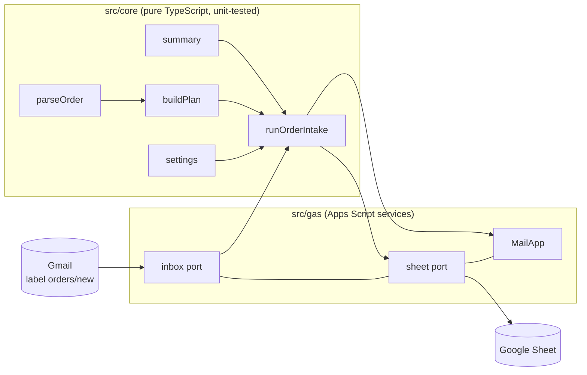

# gas-business-automation

[](https://github.com/yahayuta/gas-business-automation/actions/workflows/ci.yml)

Order-intake automation in **Google Apps Script**, written so that a business team can run it,
change it and hand it over without the person who built it.

A wholesale desk receives purchase orders by email. The script reads the emails under a Gmail
label every 15 minutes, writes one row per order line to a Google Sheet, holds doubtful orders
for review instead of guessing, and emails one summary to the team.

All customers, products and emails in this repository are fictional.

## Why it is built this way

Small Apps Script tools tend to live in one person's account, with settings hard-coded in the
source and failures that nobody notices. This repository is a template for the opposite.

| Problem seen in the field | What this repository does |
|---|---|
| To change a threshold or a recipient, someone has to edit the code | Settings live on a **Settings sheet** with a help column. The script checks every value and explains mistakes in plain words |
| A script fails at night and nobody knows | Every run writes a row to the **Run log** sheet. Failures and orders that need review are **emailed** |
| A guess ships the wrong goods | Anything the script cannot read for certain (unknown SKU, odd quantity, missing customer code, a line it cannot parse) sends the **whole order to review**. Nothing is dropped silently |
| A rerun or two overlapping runs write the same order twice | A **script lock** stops overlapping runs. Orders are written **before** the email is relabeled, and message IDs already on the sheet are skipped |
| Long runs hit the 6-minute limit | Emails are read oldest first, with a **per-run limit**; the rest wait for the next run |
| Only the author can maintain it | TypeScript with **unit tests and CI**, deployed with clasp from git, plus an [operations guide](docs/operations.md) and a [handover checklist](docs/handover.md) |

## What it looks like

The spreadsheet has four sheets, created by the menu **Order intake → Set up sheets and labels**:

| Sheet | What is on it |
|---|---|
| Settings | `inboxLabel`, `doneLabel`, `notifyTo`, `maxQuantityPerLine`, `maxMessagesPerRun`, `notifyWhenClean` |
| Orders | One row per order line: received at, message id, order no, customer, ship by, sku, quantity, status (`accepted` / `review`), reasons. Review rows are shaded |
| Products | The SKUs the desk sells. Leave it empty to skip the SKU check |
| Run log | Start and end time, status (`ok` / `review` / `skipped` / `settings-error` / `error`), counts, message |

An order email in the agreed format ([example](examples/order-email.txt)):

```text
Order No: PO-2026-0001
Customer: C-1001
Ship by: 2026-11-10
---
SKU-001, 12
SKU-014, 3
```

The parser accepts full-width characters typed with a Japanese input method, tabs or `x`
between SKU and quantity, and ignores greetings, signatures and quoted reply text.

## How it fits together



- `src/core/` holds every rule and has no Apps Script calls, so it runs in Vitest.
- `src/gas/` is the thin layer that talks to Gmail, Sheets, MailApp, LockService and triggers.
- `scripts/build.mjs` bundles everything into one `dist/Code.js` with esbuild and adds the
  top-level functions that triggers and menus call. A test loads the bundle in a sandbox to
  check that those functions exist.

## Set up

1. Create a Google Sheet, open **Extensions → Apps Script**, and copy the script ID from
   **Project Settings**.
2. Build and push:

   ```bash
   npm install
   cp .clasp.json.example .clasp.json   # paste the script ID
   npx clasp login
   npm run push                          # builds dist/ and runs clasp push
   ```

3. Reload the sheet. Use **Order intake → Set up sheets and labels**, fill in `notifyTo`, then
   **Check settings**.
4. In Gmail, add a filter that puts order emails under the label `orders/new`.
5. Try **Run now** with a test email, then **Turn on automatic runs**.

No API keys or tokens are needed: the script uses the Google account that installs it.
`.clasp.json` and clasp credentials are in `.gitignore`.

## Develop

```bash
npm install
npm test          # Vitest: parser, settings, planning, the run with fake services, the bundle
npm run check     # lint, type check, tests, build
```

The tests use fake implementations of the services, so they cover the rules but not Gmail or
Sheets themselves. After changing `src/gas/`, try **Run now** on a copy of the sheet.

## Tech stack

Google Apps Script (V8), TypeScript, esbuild, clasp, Vitest, ESLint, GitHub Actions

## How it was built

Built with an AI coding assistant (Claude). I chose the problem from what I see when business
teams take over scripts, set the constraints (fictional data only, no secrets, a non-engineer
must be able to operate it) and reviewed the result. The AI proposed the design and wrote the
code, tests, CI and documents.

## License

MIT
